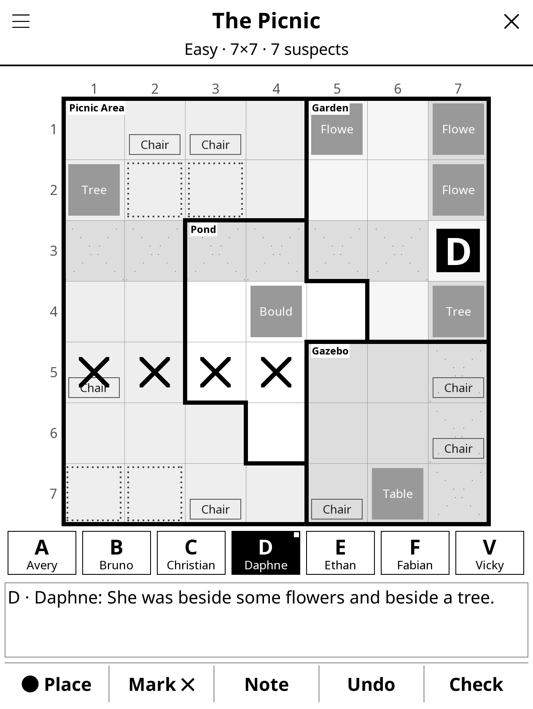
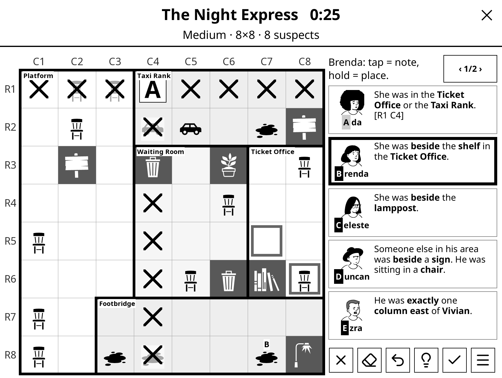
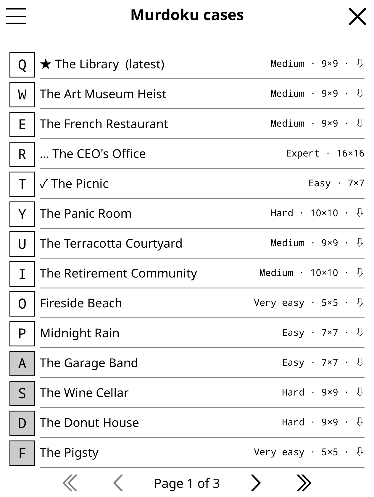

# Murdoku for KOReader

An **unofficial** [KOReader](https://koreader.rocks) plugin for playing the free
[Murdoku](https://murdoku.com) logic-mystery cases on an e-reader, designed for
touch so **no stylus or pen is needed**. Built and tested for the Kindle Paperwhite
(12th gen), and it works on any KOReader device with a touchscreen, in portrait or landscape.

> **Not affiliated with Murdoku.** This is a fan project. It is not affiliated with,
> endorsed by, or connected to Murdoku, Manuel Garand, or Digivoid Studios Inc.
> Murdoku is created by Manuel Garand. Play online and buy the books at
> **https://murdoku.com**. Murdoku™ is a trademark of Digivoid Studios Inc.
>
> **No puzzles are included in this repository.** The plugin downloads the free
> cases from murdoku.com straight onto your own device, the same files the
> website's player loads. All puzzles, names and clues are © their creators.

| Portrait | Landscape | Case list |
|---|---|---|
|  |  |  |

## Features

- Every free case on murdoku.com, including each new release (the newest is starred ★).
- **Download all cases** for offline play. Retired cases you've downloaded stay playable.
- Filter by difficulty (Very easy → Expert) and by solved/unsolved; sort by newest, oldest,
  difficulty, name or grid size. The list header shows how many cases you've solved.
- Finger-friendly controls built for e-ink:
  - Tap a suspect, then tap a square to place them. Tap again to remove.
  - **Mark** mode: tap to X out squares, or **swipe** across a row or column to X out a whole line.
  - **Note** mode: pencil in a suspect's letter as a possibility.
  - **Hold** a square to see its area and object. Hold a suspect to read their clue.
  - Unlimited undo, saved with the case so it still works after closing and reopening.
  - Check (flags misplaced suspects with **!**), step-by-step hints, reveal solution.
- Rows and columns already used by a placed suspect are dotted automatically (can be turned off).
- Obstacles (tables, trees, plants…) are dark blocks. Chairs, beds and other standable items are outlined. Carpets are dotted.
- Portrait and landscape layouts, including grids that aren't square (e.g. 11×9), up to 16×16.
- Progress is saved after every move: leave a case half-solved and pick it up later (marked … in the list).

## Install

1. Download `murdoku.koplugin.zip` from the [latest release](../../releases/latest)
   (or clone this repo).
2. Connect your Kindle over USB and copy the `murdoku.koplugin` folder into
   `koreader/plugins/` so you end up with `koreader/plugins/murdoku.koplugin/main.lua`.
3. Restart KOReader.
4. Open the top menu → **Tools** (🛠) → **Murdoku**. Turn on Wi-Fi the first time so the case list can download.

Tip: Use the ☰ menu on the case list to **Download all cases for offline play**.
You can also assign "Murdoku" to a gesture under *Settings → Taps and gestures*.

## How to play

Place every character on the crime scene so that:

- there is exactly one person in each row and each column;
- nobody stands on an obstacle;
- every suspect's clue is true ("beside" = directly left/right/above/below **and in the same area").

The murderer is the one person who was **alone with the victim** in the same area.
The game checks automatically once everyone is placed.

## Development

```
murdoku.koplugin/
  main.lua             menu entry, case list, downloads
  murdoku_game.lua     game screen, controls, portrait/landscape layout
  murdoku_board.lua    grid & suspect-bar drawing
  murdoku_puzzle.lua   puzzle JSON parser (no KOReader deps)
  murdoku_store.lua    HTTP, caching, saved progress
  murdoku_objects.lua  object table (which items can be stood on)
tests/test_puzzles.lua  parser check against a folder of puzzle JSON files
```

Run the parser test with KOReader's bundled LuaJIT against puzzles you've downloaded:

```sh
KO=/path/to/koreader
LUA_PATH="$KO/common/?.lua;;" LUA_CPATH="$KO/common/?.so;;" $KO/luajit tests/test_puzzles.lua /path/to/puzzle/jsons
```

Downloaded cases are stored in `koreader/murdoku/` on the device.

## License

The plugin code is MIT licensed (see `LICENSE`). That license covers only the code
in this repository, not Murdoku puzzles or trademarks.
